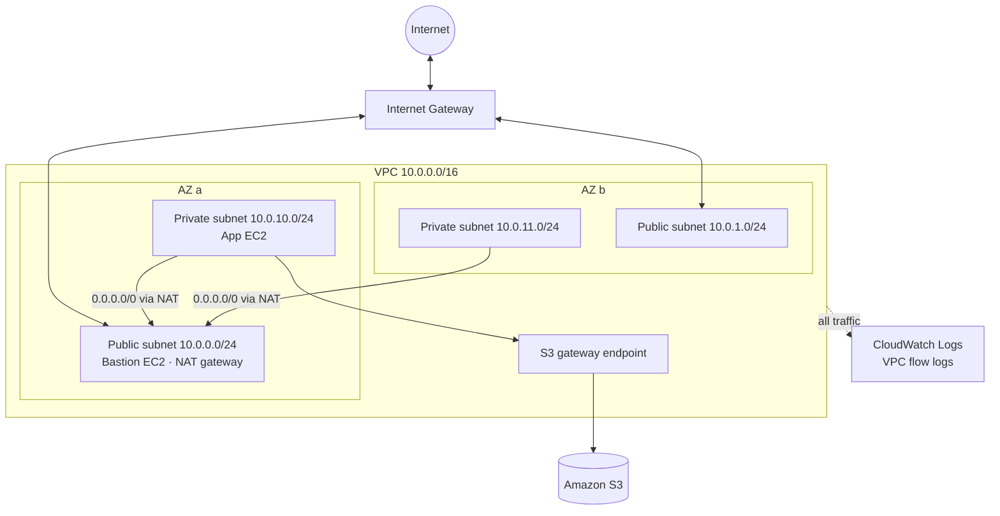

# AWS VPC with Terraform

A production-style AWS network built with Terraform: a multi-AZ VPC with public and private subnets, NAT, VPC flow logs to CloudWatch, an S3 gateway endpoint, and a bastion plus private instance to prove the routing works. Instances are reachable through **SSM Session Manager**, so no SSH port has to be open to the internet.

## Architecture



## What it builds

| Layer | Resources | Why |
|---|---|---|
| Network | VPC, 2 public + 2 private subnets across AZs, Internet Gateway | Isolates internet-facing and internal workloads; survives an AZ outage |
| Routing | Public route table → IGW; one private route table per AZ → NAT | Private hosts get outbound internet without being reachable from it |
| Egress | NAT gateway (single or one per AZ, toggle) | Trade cost against high availability with one variable |
| Private AWS access | S3 gateway endpoint | S3 traffic stays on the AWS network and skips NAT data charges |
| Security | Security groups (bastion → app by SG reference), private-subnet NACL, locked default SG, IMDSv2, encrypted volumes | Least privilege at instance and subnet level |
| Observability | VPC flow logs → CloudWatch Logs with IAM role | Troubleshoot rejected or dropped connections |
| Access | IAM instance profile with `AmazonSSMManagedInstanceCore` | Shell access with no open SSH port or key pair |

Subnet CIDRs are calculated with `cidrsubnet()`, so changing `vpc_cidr` or `az_count` reshapes the whole network.

## Project layout

```
.
├── main.tf                    # wires the modules together
├── variables.tf / outputs.tf
├── versions.tf                # provider, default tags, optional S3 backend
├── terraform.tfvars.example
├── modules/
│   ├── vpc/                   # VPC, subnets, IGW, NAT, routes, NACL, endpoint, flow logs
│   └── compute/               # security groups, SSM role, bastion + private instance
└── .github/workflows/terraform.yml   # fmt, validate and tflint on every push
```

## Usage

Prerequisites: Terraform ≥ 1.5, AWS CLI configured (`aws configure`), and the [Session Manager plugin](https://docs.aws.amazon.com/systems-manager/latest/userguide/session-manager-working-with-install-plugin.html) to connect to the instances.

```bash
cp terraform.tfvars.example terraform.tfvars   # adjust if needed
terraform init
terraform plan
terraform apply
```

### Test the network

```bash
# Shell into the bastion (public subnet) without SSH
aws ssm start-session --target $(terraform output -raw bastion_instance_id)

# From the bastion, reach the private instance
ping $(terraform output -raw app_private_ip)

# Shell into the private instance and confirm outbound internet goes through NAT
aws ssm start-session --target $(terraform output -raw app_instance_id)
curl -s https://checkip.amazonaws.com   # should match nat_gateway_public_ips
```

### Read the flow logs

```bash
aws logs tail $(terraform output -raw flow_log_group) --follow
```

Look for `REJECT` entries to see traffic blocked by security groups or NACLs.

### Tear down

```bash
terraform destroy
```

## Cost

The NAT gateway is the main cost (about $0.045/hour plus data in us-east-1, roughly $1 a day). Two `t3.micro` instances are free-tier eligible. Run `terraform destroy` when you are done, or set `enable_nat_gateway = false` and `create_instances = false` to deploy only the free parts.

## Design notes

- **Single vs per-AZ NAT:** `single_nat_gateway = true` keeps lab costs down. In production set it to `false` so losing one AZ does not cut outbound traffic for the others; the per-AZ private route tables are already in place for that.
- **SSM instead of SSH:** no inbound port 22, no key pairs to rotate, and every session can be logged. SSH from a specific IP is still available through `ssh_allowed_cidrs`.
- **Security group references:** the app instance trusts the bastion's security group, not an IP range, so the rule stays correct if the bastion's IP changes.
- **NACL + security groups:** security groups are stateful, NACLs are stateless, so the private NACL explicitly allows ephemeral return ports (1024–65535).

## Possible extensions

- Application Load Balancer in public subnets with an Auto Scaling group in private subnets
- Interface endpoints for SSM so private instances need no NAT at all
- VPC peering or Transit Gateway to a second VPC
- Remote state in S3 (see the commented backend in `versions.tf`)
